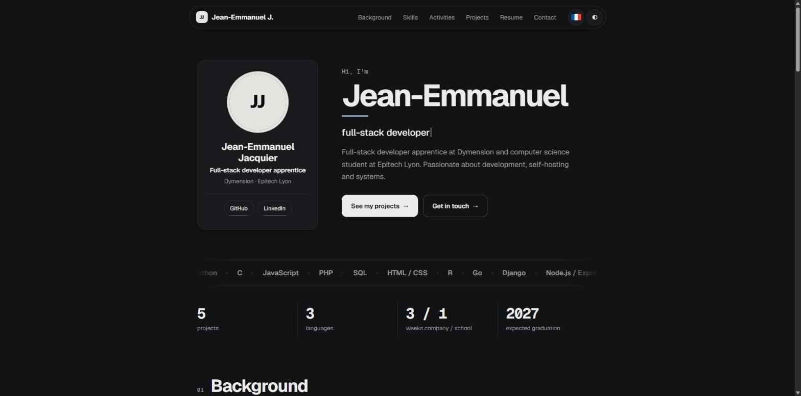

# Portfolio — Jean-Emmanuel Jacquier

Mon portfolio personnel, en ligne sur **https://portfolio.tristounet.fr**.
Site statique en HTML, CSS et JavaScript, sans framework ni étape de build, servi par nginx dans un conteneur Docker.

*English: a hand-written static portfolio (HTML/CSS/vanilla JS, no framework, no build step), bilingual FR/EN, served by a hardened nginx container.*



## Fonctionnalités

- **Bilingue français / anglais** : un dictionnaire dans `main.js`, la langue se change sans recharger la page.
- **Thème clair et sombre**, avec détection du thème du système et sans éclair blanc au chargement (`theme.js`).
- **Défilement fluide** et animations au scroll (apparitions, frise du parcours qui se remplit, compteurs, bande de technologies en boucle), écrits à la main dans `fx.js`. Les animations s'adaptent à `prefers-reduced-motion`.
- **Onglets de projets**, aperçu du CV, bouton « copier l'adresse », menu mobile.
- **Sans dépendance externe** : aucune bibliothèque, aucun CDN. Les polices (Geist, Geist Mono) sont hébergées dans le dépôt.
- **Responsive** : testé de 390 px à grand écran.

## Structure

```
site/        le site (index.html, style.css, main.js, fx.js, theme.js, polices, images)
nginx/       configuration nginx de l'image Docker (avec les en-têtes de sécurité)
deploy/      configuration réellement utilisée en production (Docker Compose + Traefik)
Dockerfile   image nginx-unprivileged contenant le site
compose.yml  lancement local
```

## Lancer en local

Avec Docker :

```bash
docker compose up --build
# puis http://localhost:8080
```

Sans Docker, n'importe quel serveur de fichiers statiques convient (par exemple `python3 -m http.server -d site 8080`),
mais les en-têtes de sécurité décrits ci-dessous ne sont alors pas appliqués.

## Sécurité

Le site est pensé pour fonctionner avec une politique de contenu stricte :

```
default-src 'self'; img-src 'self' data:; style-src 'self'; script-src 'self'; connect-src 'self';
base-uri 'self'; form-action 'none'; frame-ancestors 'none'
```

Il n'y a donc ni script ni style en ligne : tout passe par des fichiers, et les valeurs calculées (position de la frise, etc.)
sont appliquées par JavaScript via l'API CSSOM. Le conteneur tourne sans privilège, en lecture seule, avec toutes les
capacités Linux retirées (voir `compose.yml`).

## Déploiement

Sur mon serveur, le conteneur est placé derrière un reverse proxy **Traefik** qui gère le HTTPS et pose les en-têtes
(`deploy/traefik-middleware.yml`). Le dossier `site/` est monté en lecture seule dans le conteneur : une modification
d'un fichier est visible immédiatement, sans reconstruire d'image. La version de production est dans `deploy/`.

## Contenu personnel

Ce dépôt contient le **code** du site. Les fichiers `site/cv/cv-fr.pdf`, `site/cv/cv-en.pdf` et les deux aperçus
`site/images/preview_cv_*.jpg` sont ici de simples **fichiers d'exemple** : mon vrai CV (qui contient mes coordonnées)
n'est volontairement pas publié dans le dépôt. Pour utiliser ce site pour vous, remplacez-les par les vôtres, ainsi que les
textes (`main.js`, `index.html`), l'avatar et les liens. L'adresse de contact de `site/index.html`
(`prenom.nom@example.com`) est aussi un exemple à remplacer par la vôtre.

## Licence

Le **code** est sous licence [MIT](LICENSE). Les polices Geist et Geist Mono sont sous licence SIL OFL 1.1
(voir `site/fonts/LICENSES.txt`).

Les **textes, le nom, l'avatar et le contenu de mon CV** sont personnels : ils ne sont pas couverts par la licence MIT
et ne sont pas réutilisables.
